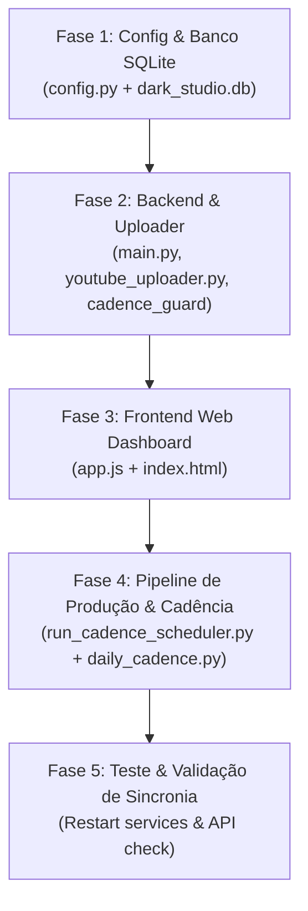

# 🚀 Plano de Implementação: Ativação do Canal #3 — "Bio Hack Longevidade"
**Destinatário:** Agente Argon (Execução, Refatoração & Integração Técnica)  
**Workspace:** `/home/eudespatricio/dark_studio_platform`  
**Status do Slot:** De *Reservado (Em Preparação)* para **ATIVO**  

---

## 1. Dados Oficiais Homologados do Canal #3

* **Nome do Canal:** `Bio Hack Longevidade`
* **Handle Oficial:** [`@BioHackLongevidade`](https://www.youtube.com/@BioHackLongevidade)
* **ID Oficial do YouTube:** `UCIjEnT4adPYVyi0UlrCITBA`
* **URL Direta:** [youtube.com/channel/UCIjEnT4adPYVyi0UlrCITBA](https://www.youtube.com/channel/UCIjEnT4adPYVyi0UlrCITBA)
* **Nicho / Categoria:** `Neurociência Aplicada, Biohacking & Longevidade Ativa` (YouTube ID: `28` - Ciência & Tecnologia)
* **RPM Estimado:** **\$12.00 a \$22.00 / 1.000 views**
* **Voz Neural (ElevenLabs):** `VR6AewLTigWG4xSOukaG` (*Dr. Viktor Kael - Clinical Futurist* / estabilidade 0.50, clareza 0.88)
* **Estilo Visual & LUT:** `cyber_biolab_clean.cube` (Cyan Split-Tone, Obsidian Black `#070A11`, Esmeralda Vitalidade `#10B981`)
* **Legendas:** `Hormozi Cyan Neon — 60px Montserrat Bold`
* **Dossiê Completo de SEO & Descrição:** [`seo_perfil_canal_cortex_longevidade.md`](file:///home/eudespatricio/.gemini/antigravity/brain/b063996b-ef61-4fa7-bf16-e4ca7987396f/seo_perfil_canal_cortex_longevidade.md)

---

## 2. Roteiro Passo a Passo de Execução para o Argon



---

### 🔹 Fase 1: Atualização das Configurações e Banco de Dados

#### 1.1 Atualizar `backend/config.py` (Slot #3 em `TOP_3_CHANNEL_PRESETS`)
Modificar o bloco do `slot: 3` em `backend/config.py`:
```python
{
    "slot": 3,
    "handle": "@BioHackLongevidade",
    "name": "Bio Hack Longevidade",
    "youtube_channel_id": "UCIjEnT4adPYVyi0UlrCITBA",
    "niche_name": "Neurociência Aplicada, Biohacking & Longevidade Ativa",
    "target_language": "pt-BR",
    "source_languages": ["en", "ja", "sv", "de"],
    "voice_id": "VR6AewLTigWG4xSOukaG",
    "voice_name": "Dr. Viktor Kael (Clinical Futurist)",
    "voice_stability": 0.50,
    "voice_similarity_boost": 0.88,
    "voice_style": 0.30,
    "visual_lut": "cyber_biolab_clean.cube",
    "visual_preset": "Neural Precision (Crisp Unsharp Mask + Cyan Split-Tone + Smooth Pan)",
    "subtitle_style": "Cyber Cyan Highlight — 60px Space Grotesk Bold",
    "bgm_profile": "minimal_modular_arp_-20dB",
    "estimated_rpm_usd": 16.50,
    "subscribers": 0,
    "total_views": 0,
    "monthly_revenue_usd": 0.00,
    "videos_published": 0,
    "active": True,
    "avatar_color": "#00F5D4",
}
```

#### 1.2 Atualizar Registro Existente no SQLite (`dark_studio.db`)
Executar script de migração no SQLite para sincronizar `channel_profiles` onde `slot = 3`:
```python
from backend.database import SessionLocal, ChannelProfile

db = SessionLocal()
ch3 = db.query(ChannelProfile).filter(ChannelProfile.slot == 3).first()
if ch3:
    ch3.name = "Bio Hack Longevidade"
    ch3.handle = "@BioHackLongevidade"
    ch3.youtube_channel_id = "UCIjEnT4adPYVyi0UlrCITBA"
    ch3.niche_name = "Neurociência Aplicada, Biohacking & Longevidade Ativa"
    ch3.avatar_color = "#00F5D4"
    db.commit()
    print("Slot 3 atualizado com sucesso no SQLite!")
db.close()
```

---

### 🔹 Fase 2: Mapeamento no Backend & Uploader

#### 2.1 Em `backend/publisher/youtube_uploader.py`:
Adicionar o mapeamento de nome e credenciais:
```python
CHANNEL_DISPLAY_NAMES = {
    "UC8RJWr3b2pKtnU1wOhV_bDQ": "A Via da Descoberta",
    "UCE6Ch6nhxI81Z6ILQIw23_Q": "Finanças Quânticas",
    "UCIjEnT4adPYVyi0UlrCITBA": "Bio Hack Longevidade",
    "ch_1": "A Via da Descoberta",
    "ch_2": "Finanças Quânticas",
    "ch_3": "Bio Hack Longevidade",
    "1": "A Via da Descoberta",
    "2": "Finanças Quânticas",
    "3": "Bio Hack Longevidade",
}
```
No método de resolução de token OAuth:
```python
elif cid_clean in ("3", "channel_3", "ch-3", "ch_3", "UCIjEnT4adPYVyi0UlrCITBA"):
    candidates = [
        "UCIjEnT4adPYVyi0UlrCITBA_token.json",
        "client_secret_ch3.json",
        "token_ch3.json",
    ]
```

#### 2.2 Em `backend/publisher/cadence_guard_filter.py` e `backend/main.py`:
* Suportar `"3"`, `"ch-3"`, `"ch_3"`, `"@BioHackLongevidade"`, `"UCIjEnT4adPYVyi0UlrCITBA"` na resolução de canais.
* Garantir que a sincronização da API (`/api/channels/{id}/sync`) consulte as métricas de `UCIjEnT4adPYVyi0UlrCITBA`.

---

### 🔹 Fase 3: Frontend Web Dashboard

#### 3.1 Atualizar `frontend/index.html`:
* Na barra superior de canais (`.channel-pill`):
  ```html
  <button class="channel-pill" data-channel="ch-3" title="@BioHackLongevidade">🥉 Bio Hack Longevidade</button>
  ```
* Nos seletores `<select id="filterChannel">`:
  ```html
  <option value="ch-3">🥉 Bio Hack Longevidade (Neurociência)</option>
  ```
* No painel de canais e tokens:
  Exibir o card ativo com link direto para `https://www.youtube.com/channel/UCIjEnT4adPYVyi0UlrCITBA` e o ID `UCIjEnT4adPYVyi0UlrCITBA`.

#### 3.2 Atualizar `frontend/app.js`:
* Atualizar o objeto de configuração de canais para slot `ch-3`:
  ```javascript
  'ch-3': {
    name: 'Bio Hack Longevidade',
    handle: '@BioHackLongevidade',
    youtubeChannelId: 'UCIjEnT4adPYVyi0UlrCITBA',
    color: '#00F5D4',
    badge: '🥉 #3'
  }
  ```
* Em `filterByChannelSlot('ch-3')`: exibir nome correto no header do dashboard.

---

### 🔹 Fase 4: Assets Visuais & Branding no Servidor

Os assets gerados já estão disponíveis em:
`/home/eudespatricio/.gemini/antigravity/brain/b063996b-ef61-4fa7-bf16-e4ca7987396f/cortex_longevidade/`

Copiar para a pasta definitiva de assets da plataforma:
```bash
mkdir -p /home/eudespatricio/dark_studio_platform/workspace/branding/ch3_biohack_longevidade/
cp /home/eudespatricio/.gemini/antigravity/brain/b063996b-ef61-4fa7-bf16-e4ca7987396f/cortex_longevidade/* /home/eudespatricio/dark_studio_platform/workspace/branding/ch3_biohack_longevidade/
```

Arquivos inclusos:
1. `cortex_longevidade_avatar_800x800.png` (Avatar vetor com monograma BH)
2. `cortex_longevidade_avatar_ai.jpg` (Avatar 3D renderizado por IA)
3. `cortex_longevidade_banner_2560x1440.png` (Banner 16:9 safe zone com título "Bio Hack Longevidade")
4. `cortex_longevidade_banner_ai.jpg` (Banner cinematográfico IA)
5. `cortex_longevidade_watermark_inscreva_se.png` (Marca d'água 300x300 Inscreva-se)
6. `cortex_longevidade_watermark_emblema.png` (Marca d'água 300x300 Emblema transparente)

---

### 🔹 Fase 5: Cadência Editorial Autônoma

Em `backend/automation/daily_cadence.py` e `run_cadence_scheduler.py`:
* Adicionar a janela de postagem do Canal 3 (sugestão: 11:30 Shorts e 18:00 Long Form).
* Ativar a esteira de pesquisa de outliers focada em:
  - *Neuroplasticidade & Foco Profundo*
  - *Autofagia & Jejum Intermitente*
  - *Saúde Mitocondrial & Longevidade Celular*
  - *Arquitetura do Sono & Recuperação Neural*

---

## 3. Checklist de Validação Final para o Argon

- [ ] `sqlite3 dark_studio.db "SELECT slot, name, handle, youtube_channel_id FROM channel_profiles WHERE slot = 3;"` retorna `Bio Hack Longevidade | @BioHackLongevidade | UCIjEnT4adPYVyi0UlrCITBA`.
- [ ] Backend FastAPI reiniciado sem erros (`./service_manager.sh restart` ou reload).
- [ ] Dashboard `http://localhost:8000` exibe a pílula do Canal 3 com cores Ciano/Esmeralda e link funcional.
- [ ] Upload manual de teste ou dry-run para o canal 3 reconhece o Channel ID correto.
