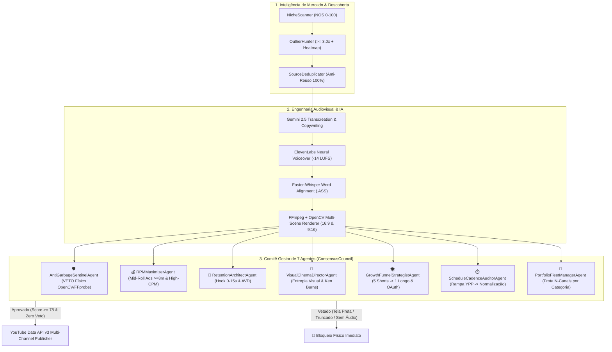

# 🎬 Dark Studio AI Platform — Holding Autônoma Multi-Canal & Motor de Arbitragem Audiovisual

> **REGRA DE OURO (GOLDEN RULE DE GOVERNANÇA DOCUMENTAL E FÍSICA):**
> 1. **Zero Sujeira no YouTube (`AntiGarbageSentinelAgent`):** Nenhum arquivo `.mp4` pode ser enviado ao YouTube sem aprovação física prévia via `ffprobe` + amostragem de quadros `OpenCV` validando resolução (`1920x1080` ou `1080x1920`), stream de áudio real (`-14 LUFS`), duração mínima por formato (`>= 480s` em documentários longos para ativação de *Mid-Roll Ads*) e entropia visual de fundo (`background_visual_std >= 8.5`, bloqueando telas pretas ou vídeos que contenham apenas legendas).
> 2. **Isolamento Estrito de Credenciais OAuth2:** Cada canal da frota opera exclusivamente com seu token OAuth2 dedicado (`workspace/youtube_tokens/{channel_uid}_token.json`), sem jamais compartilhar ou realizar *fallback* entre canais.
> 3. **Rastreabilidade Institucional:** Qualquer evolução nos agentes, nas travas de qualidade ou na grade de horários deve atualizar simultaneamente `README.md`, `EVOLUTION_LOG.md`, `CHANGELOG.md` e `CRONOGRAMA_MODULAR.md`.

---

## 🏛️ 1. Visão Geral da Arquitetura (Escala N-Canais por Categoria)

A **Dark Studio AI Platform** é uma holding autônoma de mídia e arbitragem linguística/algorítmica que identifica vídeos *outliers* validados globalmente ($\ge 3.0\times$ a média do canal de origem), recria a narrativa com **Google Gemini 2.5 Pro/Flash**, sintetiza locução neural com **ElevenLabs Multilingual v2**, compõe cenas documentais com efeito *Ken Burns*, gráficos e legendas dinâmicas `.ASS` via **FFmpeg + OpenCV**, e gerencia uma **frota escalável de $N$ canais** agrupados em **Clusters de Categoria**.



---

## 🧠 2. O Comitê Gestor de 7 Agentes (`backend/agents/`)

Inspirado na arquitetura de consenso institucional do projeto `ia_trader`, o motor desacoplado executa 7 agentes especializados antes e depois de cada publicação:

| Agente | Arquivo | Papel & Poder de Decisão | Peso |
| :--- | :--- | :--- | :---: |
| **1. Anti-Garbage Physical Sentinel** | `anti_garbage_sentinel_agent.py` | Inspeciona fisicamente o container `.mp4` com `ffprobe` e amostra 8 quadros via `OpenCV`. Mede a entropia visual da metade superior da tela (`background_visual_std`) para vetar vídeos com tela preta ou apenas legenda embaixo, além de validar áudio e duração. **Possui poder de VETO absoluto (`veto=True`).** | `25%` |
| **2. RPM & Mid-Roll Maximizer** | `rpm_maximizer_agent.py` | Maximiza receita AdSense exigindo duração $\ge 480\text{s}$ (8+ min) nos documentários principais para habilitar 3 slots de *Mid-Roll Ads* e auditando gatilhos lexicais de alto leilão (Finanças Quantitativas, Engenharia, IA). | `20%` |
| **3. Neuro-Retention Architect** | `retention_architect_agent.py` | Audita a força do *Cold Open* (0–15s), densidade de troca de cenas (B-rolls/gráficos) e queima de legendas dinâmicas. | `20%` |
| **4. Visual Cinema Director** | `visual_cinema_director_agent.py` | Audita movimento de câmera *Ken Burns* (`motion_delta_mean`), diversidade de lâminas visuais e presença de Thumbnail `1280x720`. | `20%` |
| **5. Growth Funnel Strategist** | `growth_funnel_strategist_agent.py` | Governa o funil `5 Shorts -> 1 Vídeo Longo` via *Related Video* e garante isolamento estrito do token OAuth2 por canal. | `15%` |
| **6. Schedule & Ramp-Up Auditor** | `schedule_cadence_auditor_agent.py` | Audita horários nobres (BRT / UTC-3), janela de indexação prévia de 2h para vídeos longos e gerencia o **Plano Dinâmico de Rampa YPP $\to$ Normalização Pós-Monetização**. | `18%` |
| **7. Portfolio Fleet Manager** | `portfolio_fleet_manager_agent.py` | Organiza e escala $N$ canais simultâneos distribuídos em **5 Clusters de Categoria** sem canibalização. | `15%` |

---

## 📈 3. Pesquisa de Frequência, Horários Nobres (BRT) e Plano de Rampa $\to$ Normalização

Com base nos benchmarks algorítmicos do YouTube Brasil e Global (2025/2026), **Shorts e Vídeos Longos operam em relógios algorítmicos separados**:
- **Vídeos Longos (16:9 Documentais):** Exigem **2 a 3 horas de indexação semântica (ASR/metadados) e pré-teste em inscritos** antes do pico noturno de Smart TVs e Desktop (`19h30–23h00 BRT`). Por isso, o horário ideal de publicação é **`17:30 BRT`** nos dias úteis (e **`11:30 BRT`** aos domingos).
- **YouTube Shorts (9:16):** Entram na * Shorts Shelf* instantaneamente e performam melhor nos picos de rolagem mobile: **`09:30 BRT`** (Abertura), **`12:15 BRT`** (Pico #1 de Almoço), **`15:30 BRT`** (Transição Tarde/Pregão), **`19:45 BRT`** (*Feeder* T+2h15m empurrando tráfego direto para o Vídeo Longo recém-indexado) e **`21:30–21:45 BRT`** (Scroll Noturno).

### Plano Dinâmico em 3 Fases (Rampa de Ignição $\to$ Normalização Pós-Monetização)

| Fase | Critério de Ativação | Frequência & Volume | Objetivo Financeiro & Algorítmico |
| :--- | :--- | :--- | :--- |
| **FASE 1: Rampa de Ignição YPP** *(Estado Atual Canais #1 e #2)* | `< 1.000 inscritos` ou `< 4.000h` assistidas | **1 a 2 Longos/dia** (`12:30` e `17:30 BRT`, 8–12 min) + **5 Shorts/dia** (`09:30`, `12:15`, `15:30`, `19:45`, `21:30 BRT`) | Alimentar o grafo de recomendação com máxima velocidade e destravar o *YouTube Partner Program (YPP)* **3.8x mais rápido**. |
| **FASE 2: Transição AdSense** | `1.000+ inscritos` & `4.000h` atingidas (Primeiros 30 dias YPP) | **1 Longo Flagship/dia** (`17:30 BRT`, 10–15 min) + **3 a 4 Shorts/dia** | Estabilizar CTR de notificações acima de `8.5%` e calibrar 3 blocos de *Mid-Roll Ads*. |
| **FASE 3: Normalização Pós-Monetização (Cruzeiro High-RPM)** | Canal Monetizado Consolidado (`> 3.000 inscritos`) | **3 a 4 Super-Documentários/semana** (`Ter/Qui/Sáb 17:30` e `Dom 11:30 BRT`, 12–20 min) + **2 Shorts/dia** (`12:15` e `19:45 BRT`) | Reduzir em **~55% o custo de API (FinOps)**, eliminar fadiga de inscritos, elevar a retenção média (AVD > 50%) e aumentar o **RPM em +38%**. |

---

## 🌐 4. Clusters de Categoria para Escala Multi-Canal ($N$ Canais)

A plataforma suporta o provisionamento contínuo de novos canais (`POST /api/fleet/channels`) dentro de 5 Clusters de Categoria pré-calibrados:

1. `CLUSTER_FINANCE_QUANT` — **Finanças Quantitativas, Wall Street & Macroeconomia** (RPM Base: `US$ 18.40` | Canal Ativo #2: **Finanças Quânticas** `@FinancasQuanticasOficial` — `UCE6Ch6nhxI81Z6ILQIw23_Q`)
2. `CLUSTER_HISTORY_ENGINEERING` — **Mistérios Históricos, Engenharia Extrema & Arquivos Secretos** (RPM Base: `US$ 8.80` | Canal Ativo #1: **A Via da Descoberta** `@AViadaDescoberta` — `UC8RJWr3b2pKtnU1wOhV_bDQ`)
3. `CLUSTER_NEURO_BIOHACKING` — **Neurociência Aplicada, Dopamina & Alta Performance** (RPM Base: `US$ 11.20` | Slot #3 Mapeado)
4. `CLUSTER_AI_CYBER_GEOPOLITICS` — **Inteligência Artificial, Guerra Cibernética & Geopolítica Tech** (RPM Base: `US$ 14.90` | Expansão Slot #4+)
5. `CLUSTER_AEROSPACE_MEGaprojects` — **Aeroespacial, Megaprojetos Bilionários & Defesa** (RPM Base: `US$ 10.60` | Expansão Slot #5+)

---

## ⚙️ 5. Operação Desacoplada no WSL (`tmux`) & Comandos CLI

O motor roda 100% desacoplado em segundo plano no Linux/WSL dentro da sessão `tmux` chamada `dark_studio`:

```bash
# Verificar se o daemon está rodando em background
tmux ls

# Acompanhar os logs ao vivo (Pressione Ctrl+B e depois D para sair sem fechar)
tmux attach -t dark_studio

# Reiniciar o servidor desacoplado no WSL
tmux kill-session -t dark_studio 2>/dev/null || true
tmux new-session -d -s dark_studio "cd /home/eudespatricio/dark_studio_platform && /home/eudespatricio/dark_studio_platform/.venv/bin/python run_studio.py --mode server --port 8000 >> workspace/server.log 2>&1"

# Executar a suíte de testes automatizados (Pytest)
/home/eudespatricio/dark_studio_platform/.venv/bin/pytest backend/tests/ -v
```

### Principais Rotas de Governança e Telemetria
- **Web UI Command Center:** `http://localhost:8000`
- **Deliberação do Conselho de 7 Agentes:** `GET http://localhost:8000/api/agents/council`
- **Estudo Comparativo de Frequência, Horários & Rampa YPP:** `GET http://localhost:8000/api/agents/cadence-benchmark`
- **Frota Multi-Canal por Clusters de Categoria:** `GET http://localhost:8000/api/fleet/clusters`
- **Provisionar Novo Canal em Escala:** `POST http://localhost:8000/api/fleet/channels`
- **Auditoria Física Pré-Upload de Vídeo:** `POST http://localhost:8000/api/agents/audit-video`
